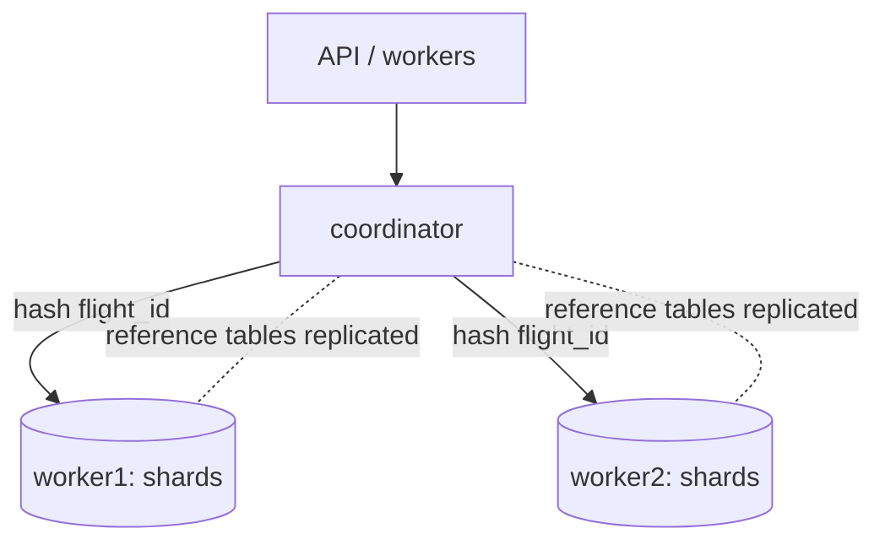
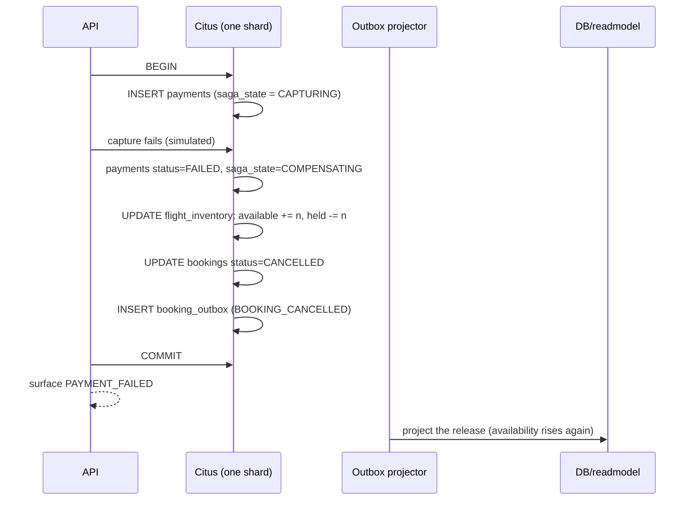

# Architecture

This document describes how the system is put together and *why*. It is grounded in
`db/migrations/`, `src/config/constants.js`, `src/db/citus.js` and `src/db/pool.js`; where a
statement references a table or constraint, the definition is in those migrations.

---

## 1. Two data models

### Write model (strongly consistent) — Citus

The authoritative state. Everything a booking changes lives here, distributed by `flight_id`:

| Table | Distribution | Partitioned by | Notes |
|---|---|---|---|
| `flights` | `flight_id` | `departure_date` | schedule/route/fare facts |
| `flight_inventory` | `flight_id` (colocated) | `departure_date` | the counter — `total_seats`, `available_seats`, `held_seats`, `version` |
| `bookings` | `flight_id` (colocated) | `departure_date` | one row per booking; `seat_number` when a seat is held |
| `payments` | `flight_id` (colocated) | `departure_date` | saga state machine per booking |
| `booking_outbox` | `flight_id` (colocated) | `departure_date` | transactional outbox |
| `user_bookings` | **`user_id`** | — | per-user projection; *not* colocated (different key) |
| `refresh_tokens` | **`user_id`** | — | colocated with `user_bookings` |

Reference (replicated) tables: `airlines`, `airports`, `cabins`, `aircraft_types`,
`seat_map_templates`, `users`. They are small and joined by almost everything, so Citus replicates
them to every worker (`create_reference_table`) and joins are local.

### Read model (eventually consistent) — separate PostgreSQL

`flight_availability`, partitioned by `departure_date`, plus `projection_state`. This is what
`GET /api/flights` searches. It is a projection: it can be dropped and rebuilt from the write model
(`npm run readmodel:reproject`), which is exactly why search is allowed to lag.

---

## 2. Citus topology



- **Coordinator.** Plans and routes; holds no business data. Every application query goes through
  it (or PgBouncer in front of it). It reads `pg_dist_node`, `pg_dist_partition` and `citus_shards`
  for status.
- **Workers.** Own the shards. A hash range of `flight_id` namespaces is assigned to each;
  `flights_102008`-style tables are the physical shards.
- **Colocation groups.** Tables created with `colocate_with => 'flights'` share a colocation id.
  Rows whose `flight_id` falls in the same hash range land on the *same* shard on the *same* worker
  for every colocated table. That is the property that makes a booking a single-worker transaction.
- **Distribution discriminates behavior.** `src/db/citus.js` inspects the cluster: if the `citus`
  extension is present *and* at least one active primary worker is registered, it distributes and
  references; otherwise (vanilla PostgreSQL 18, CI, the local no-Docker path) it creates the same
  tables as plain local tables. The schema is identical either way — only placement differs.

Shard count for the independently-distributed tables comes from `CITUS_SHARD_COUNT` (default 32);
colocated tables inherit the group's shard count from `flights`.

---

## 3. The booking transaction, statement by statement

With `BOOKING_SAGA_INLINE=true` (the default), one request runs the whole thing inside a single
transaction on a single connection (`withTransaction`, `src/db/pool.js`). Every statement below
carries a `flight_id` *and* `departure_date`, so Citus routes each one to the same shard:

| # | Statement (conceptual) | Table / shard |
|---|---|---|
| 1 | `UPDATE flight_inventory SET available_seats = available_seats - n, held_seats = held_seats + n WHERE flight_id=$1 AND departure_date=$2 AND cabin=$3 AND available_seats >= n RETURNING version` | `flight_inventory` — the booking's shard |
| 2 | `INSERT INTO bookings (...) VALUES (...) RETURNING booking_id` | `bookings` — same shard (colocated) |
| 3 | `INSERT INTO payments (...) VALUES (...)` | `payments` — same shard |
| 4 | `UPDATE payments SET status='AUTHORIZED', saga_state='AUTHORIZED' ...` | `payments` — same shard |
| 5 | `UPDATE bookings SET status='CONFIRMED', confirmed_at=now() ...` and `UPDATE flight_inventory SET held_seats = held_seats - n` | `bookings` + `flight_inventory` — same shard |
| 6 | `INSERT INTO booking_outbox (...) VALUES (...)` | `booking_outbox` — same shard |

Because statements 1–6 share one shard, PostgreSQL commits them as **one local transaction**: no
two-phase commit, no distributed deadlock, one `COMMIT`. If the requested seat is supplied and
`SEAT_ASSIGNMENT_MODE=requested`, the `uq_live_seat` partial unique index (on
`bookings(flight_id, departure_date, seat_number) WHERE seat_number IS NOT NULL AND status IN
('PENDING','CONFIRMED')`) is the hard guarantee that two live bookings never share a seat.

The connection is retried as a whole by `executeWithRetry` (`src/concurrency/transactionRetry.js`)
on transient SQLSTATEs (40001, 40P01, 55P03, connection loss, …) — never just the last statement —
so a retry replays a transaction that provably did not commit.

---

## 4. The inventory counter and why it cannot oversell

The anti-oversell invariant is one conditional `UPDATE` against `flight_inventory`:

```sql
UPDATE flight_inventory
   SET available_seats = available_seats - $n,
       held_seats      = held_seats + $n,
       version         = version + 1,
       updated_at      = now()
 WHERE flight_id = $1 AND departure_date = $2 AND cabin = $3
   AND available_seats >= $n
RETURNING version;
```

Why this cannot oversell:

1. The `WHERE available_seats >= $n` predicate is evaluated by the database **while holding the row
   lock** it takes to perform the update. Two concurrent buyers of the last seat serialize on that
   lock; the first decrements `available_seats` to 0, and the second's predicate is re-evaluated
   against the committed value, so it matches **zero rows** and returns no row. Zero rows updated is
   a clean, unambiguous `SOLD_OUT`/`SEAT_UNAVAILABLE` outcome — not an error to retry.
2. `CONSTRAINT inv_capacity CHECK (available_seats + held_seats <= total_seats)` is a second,
   database-enforced line of defence: even if application logic above were wrong, the accounting
   identity cannot be violated. A violation surfaces as `INVENTORY_INVARIANT_VIOLATION`, a
   correctness alarm, never a silent overbook.
3. `CONSTRAINT inv_non_negative` (`available_seats >= 0`) prevents a negative counter outright.

There is no read-then-write race: the version is returned for optimistic bookkeeping and for the
read model, but correctness rests entirely on the conditional update and the CHECK constraints.

### Sharded-counter variant (`INVENTORY_STRATEGY=sharded`)

A single hot flight's counter is one row, and every buyer takes the same row lock — a throughput
ceiling. In `sharded` mode the capacity is spread across `INVENTORY_SHARD_COUNT` rows keyed by
`shard_no`, so buyers contend on separate rows. Availability for a cabin is then
`SUM(available_seats) ... GROUP BY cabin`.

The cost is real and is why `single` is the default:

- Reads must aggregate N rows instead of reading one.
- The reservation must pick a shard and handle the case where the chosen shard is empty but others
  are not (retry on another shard, or reserve a fraction).
- The booking records **which** `inventory_shard` it decremented (`bookings.inventory_shard`), so a
  later confirm/compensate releases the *exact* row it held — otherwise the release would have to
  scan every shard and the single-shard property would be lost.

---

## 5. Seat assignment modes

Controlled by `SEAT_ASSIGNMENT_MODE`:

- **`requested`** (default) — the caller may name a seat. It is reserved atomically, guarded by the
  `uq_live_seat` partial unique index. Requesting a taken seat returns `SEAT_UNAVAILABLE`.
- **`lazy`** — bookings hold only counts; no `seat_number` is stored at booking time and seats are
  assigned later (check-in style). The `uq_live_seat` index simply does not apply to rows with a
  null seat, so lazy bookings never contend on a seat number.

The seat *map* endpoint works in both modes: it derives seats from
`seat_map_templates` (by aircraft type + cabin) and left-joins whatever specific seats are currently
held. Seats live in a template, not as rows per flight — the same 10-billion-row argument as the
counter.

---

## 6. Partitioning and retention

`flights`, `flight_inventory`, `bookings`, `payments`, `booking_outbox` and the read model's
`flight_availability` are all `PARTITION BY RANGE (departure_date)` with **monthly** partitions
named `<parent>_p<YYYYMM>`.

- Partitions exist to make pruning possible. A route/date search prunes to the few partitions that
  cover the date range; a booking touches exactly one month.
- `ck_flights_departure_date` forces `departure_date = (departure_time AT TIME ZONE 'UTC')::date`,
  so a row cannot be parked in a month that does not match its departure time.
- `app_ensure_month_partitions(parent, months_behind, months_ahead)` creates the window; migration
  `007` seeds it with `PARTITION_MONTHS_BEHIND..PARTITION_MONTHS_AHEAD`. `npm run partitions:maintain`
  runs it forward and drops months older than `PARTITION_RETENTION_MONTHS`.
- If a month's partition does not exist, the insert **fails loudly** (`no partition of relation
  found for row`) — never a silently dropped row. This is the single most common bulk-load mistake;
  see [DATA_LOADING.md](DATA_LOADING.md).

---

## 7. The booking saga

A booking is a saga with compensations, and the payment row records how far it got so a crash can be
reconciled from the database rather than from process memory. `payments.saga_state` takes the values
in `SAGA_STATE` (`src/config/constants.js`):
`RESERVED → AUTHORIZING → AUTHORIZED → CAPTURING → CAPTURED → CONFIRMED`, with `COMPENSATING →
COMPENSATED` and `FAILED` as terminal branches.

### Happy path

```mermaid
sequenceDiagram
  participant C as Client
  participant A as API
  participant R as Redis (idempotency)
  participant DB as Citus (one shard)
  participant O as Outbox projector

  C->>A: POST /api/bookings (Idempotency-Key)
  A->>R: SET NX idem:<scope>:<key>
  R-->>A: acquired
  A->>DB: BEGIN
  DB->>DB: UPDATE flight_inventory -n WHERE available_seats >= n
  DB->>DB: INSERT bookings (PENDING, hold_expires_at)
  DB->>DB: INSERT payments (RESERVED)
  A->>DB: authorize (simulated) -> payments AUTHORIZED
  A->>DB: capture -> payments CAPTURED
  DB->>DB: UPDATE bookings CONFIRMED; held -> sold
  DB->>DB: INSERT booking_outbox (BOOKING_CONFIRMED)
  A->>DB: COMMIT
  DB-->>A: committed
  A->>R: store result against the idempotency key
  A-->>C: 201 Created
  O->>DB: poll unpublished outbox
  O->>DB/readmodel: project flight_availability + user_bookings
```

### Compensation (payment fails or capture is abandoned)



Compensation is a normal transaction, applied to the same shard as the reservation, so it is atomic
and idempotent when replayed. The persisted `saga_state` is what makes recovery possible after a
crash: `npm run saga:reconcile` finds payments stuck in a non-terminal state and re-drives them.

### Crash recovery state

| Where | Field | Why it matters |
|---|---|---|
| `bookings` | `status`, `hold_expires_at` | the reaper can release a `PENDING` hold that never settled |
| `bookings` | `inventory_shard` | the exact counter row to release |
| `payments` | `saga_state` | how far the sequence got; drives reconciliation |
| `booking_outbox` | `published`, `attempts`, `last_error` | safe at-least-once projection with a parked dead-letter |

---

## 8. The outbox and the projector

The outbox solves the dual-write problem: the event describing a change is inserted **in the same
transaction** as the change, so it is impossible to commit the change and lose the event.

`booking_outbox` rows carry `event_type` (one of `OUTBOX_EVENT_TYPES`), `aggregate_id`, `user_id`,
`payload jsonb`, and `published`/`attempts`/`last_error`. A partial index
(`idx_outbox_unpublished ON booking_outbox (created_at) WHERE published = false`) is the poll path.

The projector, per event, performs three writes **in this order**:

1. **Upsert `flight_availability`** (read model) from the event payload, only when the event's
   `source_version` is not older than the row already present (out-of-order events are discarded,
   not allowed to overwrite fresher data).
2. **Upsert `user_bookings`** (the per-user index) for booking events, so `GET /api/me/bookings` is
   a single-shard lookup by `user_id`.
3. **Mark the outbox row `published = true`** and advance `projection_state.last_event_at` /
   `last_event_id`.

Ordering is the point: the read-model writes happen *before* the row is marked published, so a crash
between them leaves the outbox row unpublished and the event is simply reprojected on the next poll.
Every projection is an idempotent upsert, so at-least-once delivery converges. After
`OUTBOX_MAX_ATTEMPTS` the row is left unpublished with `last_error` set (a parked dead-letter) rather
than dropped.

---

## 9. Idempotency, in two layers

1. **Front: Redis `SET NX`.** `POST /api/bookings` first attempts
   `SET idem:<scope>:<key>` (via `src/cache`). If it is not acquired, the request is a replay: the
   stored response is returned with `isIdempotentReplay: true`. This is fast and stops duplicate work
   before it reaches the database. It is an *optimization*: the in-process fallback driver is
   per-process, so with `REDIS_URL` unset it does not deduplicate across API instances.
2. **Behind: the partial unique index.** `uq_booking_idempotency`
   (`UNIQUE (flight_id, departure_date, idempotency_key) WHERE idempotency_key IS NOT NULL`) is the
   backstop. Two concurrent retries that both slip past Redis race to insert; the loser gets a unique
   violation and is answered as a replay/conflict. The index is per-flight, not global, because a
   distributed table's unique index must include the distribution column — cross-flight idempotency
   is therefore owned by the Redis record, and the index covers the concurrency case.

The same two-layer shape protects specific seats (`uq_live_seat`) and booking references
(`uq_booking_reference`).

---

## 10. The read model and freshness

Search never touches booking shards. `flight_availability` is one denormalized row per
`(origin, destination, departure_date, flight_id, cabin)` with `total_seats`/`available_seats`/
`held_seats`/`price`/`status` and a `source_version`. Indexes support the actual search access path
(route + date + remaining seats) and a flight-id lookup for reprojection.

Freshness is **reported, not hidden**: each search response carries `x-read-model-lag-ms` (the
`HEADERS.READ_MODEL_LAG` header), derived from `projection_state` and the outbox. A lag above
`READMODEL_LAG_SLA_SECONDS` means the projection is stale and is treated as a degraded signal.

**Scaling reads.** The projector always writes to `READMODEL_URL`; search can be pointed at a
separate read replica with `READMODEL_READ_URL`. Wide, sorted searches then never compete with the
outbox batches applying to the primary, at the cost of the replica's own replication lag — which is
still surfaced through the same freshness header, because lag is measured from the copy the caller
actually queried.

---

## 11. Failure modes

| Failure | Expected behaviour |
|---|---|
| **A worker is down** | Only the shards it owns are unavailable. Bookings and searches whose `flight_id` hashes elsewhere keep working; affected ones fail with `DATABASE_UNAVAILABLE`/transient, and `executeWithRetry` retries a bounded number of times. No data is at risk — the coordinator fences the failed shard. |
| **Coordinator is down** | The API cannot route anything: reads and writes fail fast with `DATABASE_UNAVAILABLE` (health reports `writeModel: DISCONNECTED`). The read model, if it is a separate database, keeps serving search. Workers keep polling when the coordinator returns. |
| **Redis is down** | The cache facade logs once and degrades to the in-process driver. Booking still works — idempotency falls back to the database's partial unique index. Rate limiting degrades, and refresh-token revocation helpers degrade to the DB. Nothing correctness-critical is lost. |
| **Read model lagging** | Search serves stale availability and advertises it via `x-read-model-lag-ms`. Bookings are unaffected (they read the write model). When lag exceeds the SLA the projection is considered stale; `readmodel:reproject` can rebuild it. |
| **Hold reaper races a payment** | The reaper releases only holds whose `hold_expires_at` has passed **and** that are still `PENDING`, in its own transaction. If a payment confirms first, the row is no longer `PENDING` and the reaper's conditional update matches zero rows. If the reaper wins, the payment path sees the booking already `EXPIRED` and fails the charge with `HOLD_EXPIRED`. Because both are conditional single-shard updates, exactly one of them succeeds. |

---

## 12. Related documents

- Operations and incident playbooks: [RUNBOOK.md](RUNBOOK.md)
- Loading your own flights/users: [DATA_LOADING.md](DATA_LOADING.md)
- The MongoDB → Citus migration: [MIGRATION_FROM_MONGODB.md](MIGRATION_FROM_MONGODB.md)
- Test suites and acceptance criteria: [TESTING.md](TESTING.md)
